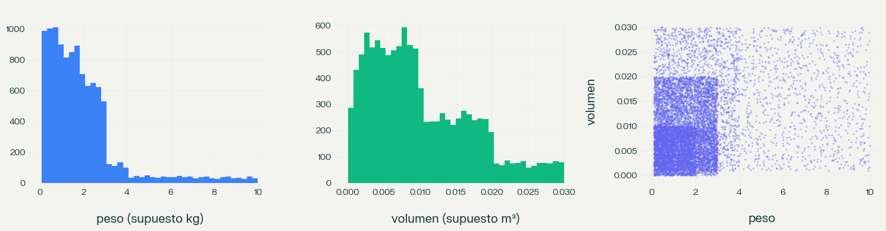
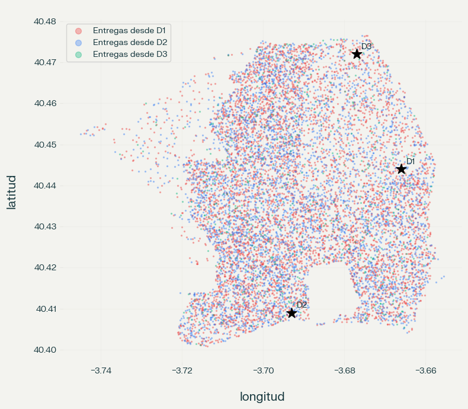
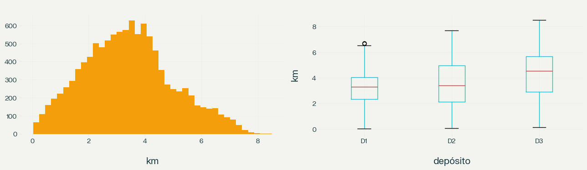
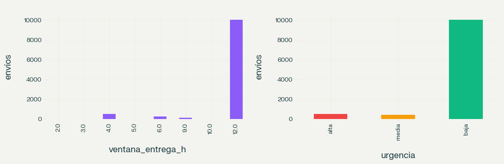
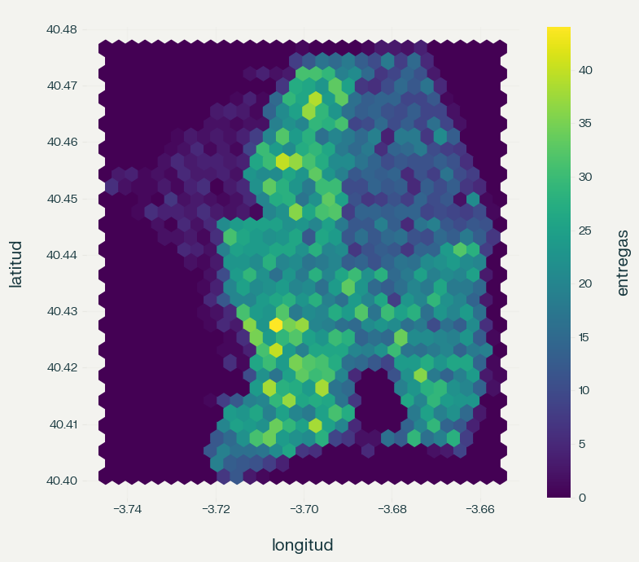

# Análisis exploratorio y limpieza de datos (Semana 1)

**Proyecto:** Agente de optimización de rutas y logística de entregas (Grupo 3)
**Dataset:** `parcel_demand_scenario_1.csv`
**Código que lo reproduce:** `notebooks/01_analisis_exploratorio.ipynb`
**Resultado:** `backend/data/processed/envios_limpio.csv`

## 1. Para qué sirve este análisis

El agente va a decidir qué paquetes van en cada vehículo y en qué orden se entregan. Esas decisiones dependen de las coordenadas, el peso, el volumen y los horarios, así que antes de construirlo hay que comprobar que esos datos están completos, son coherentes y se entienden bien.

## 2. Resumen de resultados

| Aspecto | Resultado |
|---|---|
| Tamaño | 10.984 filas y 10 columnas (el enunciado exige al menos 5.000) |
| Valores nulos | 0 |
| Filas duplicadas | 0 |
| Filas descartadas por validación | 0 |
| Depósitos (puntos de retiro distintos) | 3 (52,9 %, 41,6 % y 5,4 % de los envíos) |
| Distancia retiro–entrega | De 0,04 a 8,5 km, con una media de 3,4 km |
| Ventanas de entrega de 12 horas | 91 % de los envíos |
| Zonas de 1 km con entregas | 60 |

## 3. Calidad y validaciones

- **Nulos y duplicados:** no hay. Por eso no se eliminó ni se completó ningún dato, y no se inventaron errores para tener algo que corregir.
- **Nombres y tipos:** el encabezado `Latitute_pick_up` tiene un error de tipeo, y los nombres mezclan mayúsculas y minúsculas. Se normalizaron a español y minúsculas (`lat_origen`, `peso`, etc.). Los cuatro horarios estaban guardados como texto y se convirtieron a minutos desde las 00:00 para poder restarlos y compararlos.
- **Reglas de coherencia:** se comprobó que las coordenadas estén en rango, que peso y volumen sean mayores que cero y que cada ventana termine después de empezar. Ninguna fila incumple las reglas.
- **Hallazgo:** en todas las filas la entrega termina exactamente 1 hora después de que termina el retiro. Esto indica que el dataset fue generado con una regla fija y no tomado de entregas reales, algo que hay que decir al explicar el origen de los datos.

## 4. Peso y volumen

- El peso va de 0,1 a casi 10 y se concentra en valores bajos: la mediana es 1,56 y la media 1,96.
- Hay 728 pesos por encima del límite estadístico (1,5 veces el rango intercuartil, unos 5,07), pero son paquetes de entre 5 y 10: valores posibles, no errores. **No se eliminan**, porque quitarlos distorsionaría la carga real que el agente debe repartir.
- El volumen es muy pequeño (hasta 0,03). Hay 31 envíos con volúmenes casi nulos (menos de 0,0001): son raros pero positivos, así que se conservan y quedan documentados.
- La correlación entre peso y volumen es baja (0,26). Un vehículo se puede llenar por peso o por volumen, y el agente tiene que controlar las dos capacidades por separado.
- **Unidades:** el archivo no las indica. Se asumen kg y m³ porque los rangos son razonables para paquetes con esas unidades. Es un supuesto a confirmar con la fuente.

## 5. Ubicaciones y depósitos

- Hay 3 puntos de retiro, que se tratan como los depósitos D1, D2 y D3.
- Las entregas de los tres depósitos se mezclan en el mismo territorio: el centro de las entregas de cada uno difiere en menos de 0,001 grados (unos 100 metros). Por eso la asignación de paquetes a depósitos no está dada por la geografía, y el agente tiene que trabajar con el depósito de origen que cada paquete ya trae.
- Los destinos son casi todos distintos, así que no hay entregas repetidas en una misma dirección que se puedan juntar sin más.

## 6. Distancias

- Se calculó la distancia en línea recta entre retiro y entrega con la fórmula de Haversine. Es menor que el recorrido real por calles, así que sirve para comparar y ordenar, pero subestima los kilómetros reales.
- Las distancias van de unos 40 metros a unos 8,5 km. D3 tiene distancias algo mayores (media de 4,3 km frente a 3,2 y 3,6 km de D1 y D2).
- Como las distancias son cortas, el tiempo de cada parada puede pesar tanto como el viaje. El agente necesitará un tiempo de servicio por parada, que el dataset no trae y habrá que suponer.

## 7. Ventanas horarias y urgencia

- El 91 % de los envíos tiene una ventana de 12 horas (de 09:00 a 21:00). Solo cerca del 9 % tiene ventanas más cortas, de entre 2 y 10 horas.
- Se definió la urgencia con una regla propia: **alta** si la ventana dura 4 horas o menos (514 envíos), **media** hasta 9 horas (432) y **baja** si dura más (10.038). Los cortes separan los grupos que aparecen en los datos. Es una decisión del grupo y hay que justificarla en la exposición.
- Casi todo es flexible, así que para probar la tasa de entregas a tiempo hay que mirar el pequeño grupo urgente, que es donde el agente puede fallar. La proporción de urgencias es parecida entre depósitos.

## 8. Zonas y densidad

- Se dividió el mapa en celdas de 0,01 grados (cerca de 1 km) según el destino. Resultaron 60 zonas, desde zonas de borde con 1 a 14 entregas hasta zonas con más de 400. La mediana es de unas 178 entregas por zona.
- El tamaño de celda es una simplificación inicial. En la etapa del agente se puede reemplazar o complementar con un agrupamiento más fino, y comparar el resultado con estas zonas.

## 9. Columnas nuevas

Todas se calculan a partir de datos que ya existen. No se inventó información.

| Columna | Se calcula con |
|---|---|
| id_envio | Número de fila |
| id_deposito | Coordenadas de retiro |
| distancia_km | Coordenadas (Haversine) |
| ventana_entrega_h | Horarios de entrega |
| urgencia | Ancho de la ventana |
| tiempo_viaje_min | Distancia y velocidad supuesta de 25 km/h |
| zona_id y densidad_zona | Coordenadas de entrega y conteo por zona |
| origen_dato | Marca de trazabilidad (`original` o `generado`) |

El dataset final tiene 10.984 filas y 23 columnas.

## 10. Conclusiones

**Qué decidimos**
- No eliminar ni imputar datos, porque no hay errores que corregir.
- Mantener los valores extremos de peso y volumen por ser posibles.
- Definir urgencia, zona y depósito con reglas propias, documentadas arriba.
- Crear columnas calculadas en lugar de generar datos nuevos.

**Limitaciones y supuestos a declarar**
- Unidades de peso y volumen no indicadas (se asumen kg y m³).
- La entrega termina siempre 1 hora después del fin del retiro: el dataset parece generado con reglas.
- La distancia es en línea recta, no por calles.
- La velocidad de 25 km/h es un supuesto.
- Faltan datos de flota y tiempos de parada, que habrá que definir (la flota se propone como tabla aparte).

**Cómo lo usa el agente**
- Asignar paquetes a vehículos controlando peso y volumen por separado.
- Priorizar el pequeño grupo de urgencia alta y comprobar que se cumplan sus horarios.
- Agrupar por cercanía usando las zonas como punto de partida.
- Medir los resultados con los KPI del enunciado: kilómetros por ruta y tasa de entregas a tiempo.
